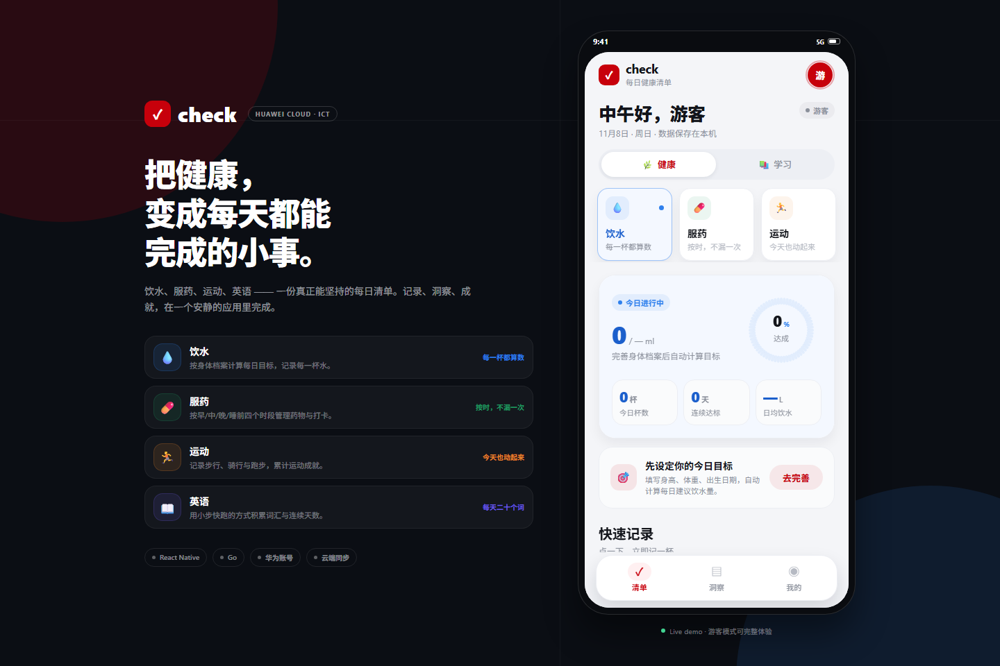
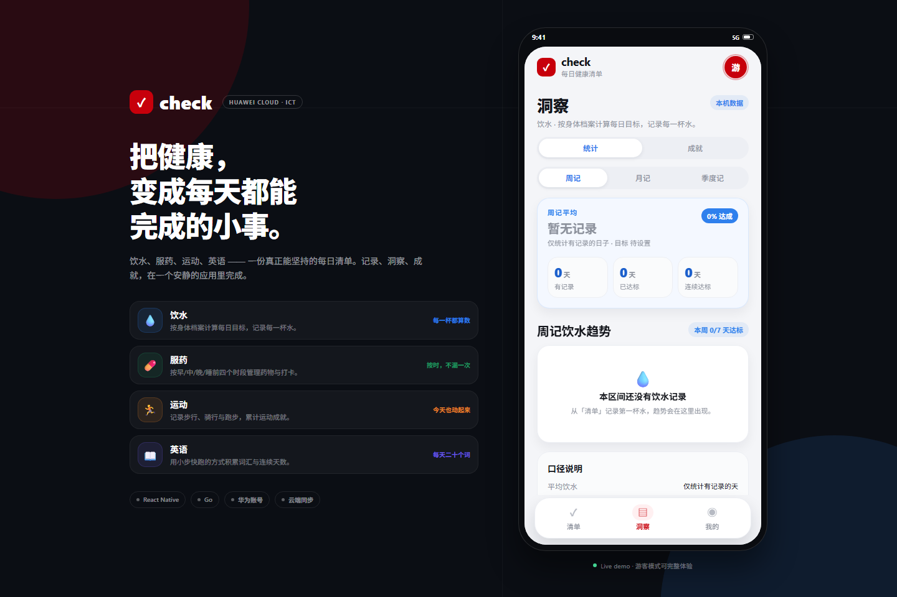
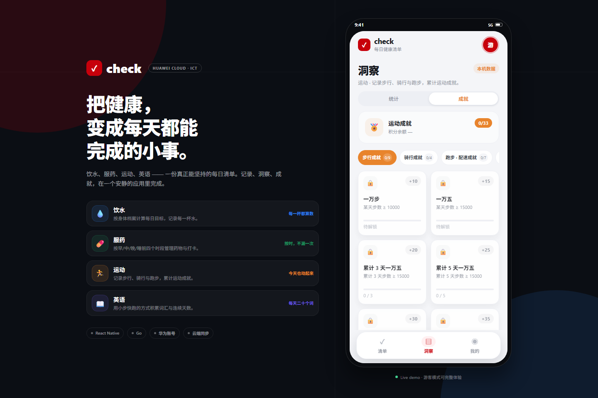
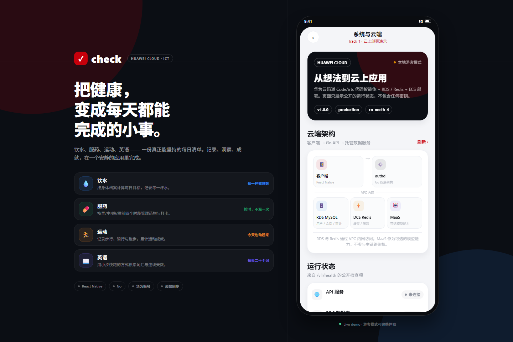
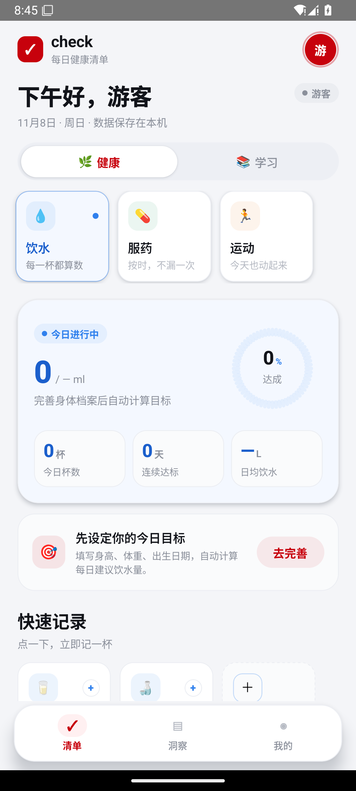
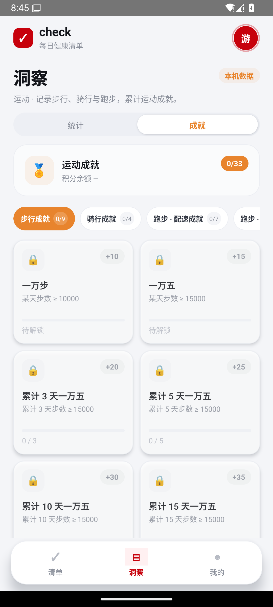
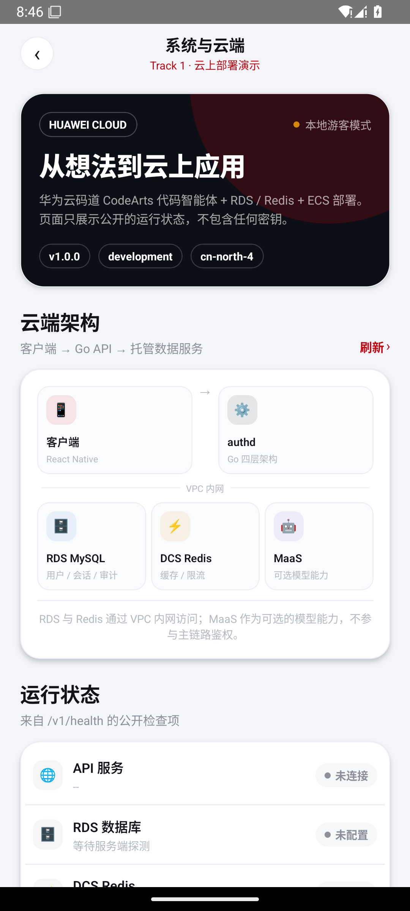
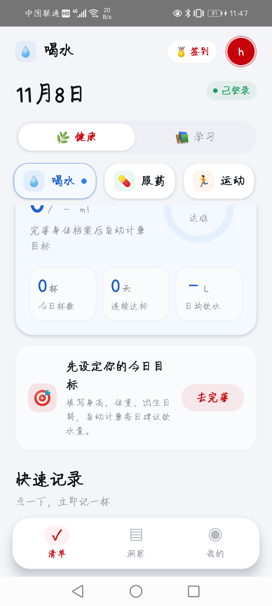
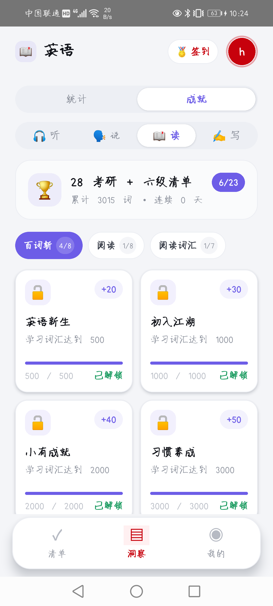

# check · 每日健康清单

> 华为 ICT 大赛 **赛题一** 作品：用华为云码道 CodeArts 代码智能体完成「想法 → 应用 → 云上 Demo」的完整闭环。
>
> 饮水、服药、运动、英语 —— 一份真正能坚持的每日清单。



## 这是什么

`check` 是一个跨端每日健康清单：

- **饮水**：按身体档案计算每日目标，支持杯子 / 瓶装水 / 自定义单位，记录可撤销。
- **服药**：按早 / 中 / 晚 / 睡前四个时段管理药物，支持补打与撤回。
- **运动**：记录步行、骑行、跑步，按周 / 月 / 季度看趋势；成就页用 nav 栏切换步行 / 骑行 / 配速 / 距离 / 连击分组。
- **英语**：一级「英语」，二级「听 / 说 / 读 / 写」；28 考研 + 六级清单按技能归组；成就按起点/终点对数插值生成，每条清单独立记录进度和目标，技能目标支持按天 / 按周 / 按月。
- **数据洞察**：统计 / 成就二级页面，按清单记忆浏览位置。
- **签到与头像框**：积分、连续签到、像素头像框兑换与装备。
- **系统与云端**：实时查看 API / RDS / Redis / 华为账号 / MaaS 健康状态，以及 CodeArts 五步开发闭环。

三端同一套 React Native 代码（Web / Android / Windows），服务端是 Go 标准库四层架构。

## 快速开始

### 方式 A：只看 Web Demo（无需后端）

```bash
cd app
npm ci
npm run web:dev
```

打开 `http://127.0.0.1:3000/?demo=guest`。

游客模式零网络请求，所有清单数据保存在浏览器本地；适合快速评审界面与交互。

### 方式 B：完整本地联调

```bash
# 一条命令启动 hwsim + authd + Web 开发服务器（推荐）
npm run demo

# 或分开启动：
# 终端 1：根目录，启动 hwsim + authd + Metro + 静态预览
npm start
# 终端 2：Web 前端（同源代理 /v1 到 8443）
cd app && npm run web:dev
```

打开 `http://127.0.0.1:3000/` 登录，或 `?demo=guest` 直接进入游客主页。

### 方式 C：Docker 一键 Demo

```bash
cp deploy/env.example deploy/.env
# 至少修改 SESSION_PEPPER / MYSQL_PASSWORD / REDIS_PASSWORD
docker compose -f deploy/docker-compose.yml --env-file deploy/.env up -d --build
```

打开 `http://127.0.0.1:8088/?demo=guest`，健康检查 `http://127.0.0.1:8088/v1/health`。

### 方式 D：Android 手机 / 模拟器调试

```powershell
# 必须从纯 ASCII 路径构建（中文路径会让 CMake/Ninja 失败）
# 详细步骤、JDK/SDK/NDK/Metro 配置见 docs/native-build.md
cd D:\ict_build\app\android
.\gradlew.bat assembleDebug -PreactNativeArchitectures=x86_64 --no-daemon `
  -I ..\..\.dev\mirror.init.gradle
adb install -r .\app\build\outputs\apk\debug\app-debug.apk
adb reverse tcp:8081 tcp:8081
cd D:\ict_build\app
npx react-native start --host 0.0.0.0 --port 8081
adb shell am start -n com.checkism.app/.MainActivity
```

独立安装包（内嵌 JS，不需要 Metro）：

```powershell
cd D:\ict_build\app\android
.\gradlew.bat assembleRelease -PreactNativeArchitectures=arm64-v8a --no-daemon `
  -I ..\..\.dev\mirror.init.gradle
adb install -r .\app\build\outputs\apk\release\app-release.apk
```

已在 Android 15 模拟器验证游客主页、洞察、运动成就 nav 栏、我的、系统与云端；完整说明见 [docs/native-build.md](docs/native-build.md)。

## 赛题一交付索引

| 交付项 | 位置 |
|---|---|
| 赛题要求对照、Demo 脚本、CodeArts 使用记录 | [`docs/track1.md`](docs/track1.md) |
| 华为云 ECS / RDS / DCS 部署手册 | [`deploy/README.md`](deploy/README.md) |
| RDS for MySQL schema 基线 | [`db/schema.sql`](db/schema.sql) |
| Docker / Compose / Nginx | [`deploy/`](deploy/) |
| 华为账号登录规格与验收 | [`.codeartsdoer/specs/huawei_id_login/spec.md`](.codeartsdoer/specs/huawei_id_login/spec.md) |
| 开源许可证 | [`LICENSE`](LICENSE) |

云端健康检查会返回：

```json
{
  "status": "ok",
  "checks": {
    "config": "ok",
    "storage": "ok",
    "huawei": "ok",
    "rds": "ok",
    "redis": "ok",
    "maas": "not_configured"
  },
  "cloud": { "provider": "huaweicloud", "region": "cn-north-4", "deploymentId": "check-demo-001" }
}
```

未配置 RDS / Redis / MaaS 时对应项为 `not_configured`，不会伪造连接。

## 架构与扩展

```text
app/src/
  app/          应用外壳（宽屏产品叙事 + 手机预览）、导航守卫
  features/     按业务切片：water / medication / sport / english / profile
  features/registry.tsx  清单面板注册表（新增清单只改这里）
  ui/           设计令牌 + 基础组件 + 成就墙 + 圆环
  screens/      登录 / 主壳 / 数据 / 签到 / 系统与云端
  api/          接口客户端（超时、错误分流、traceId）
  check/        清单状态与本地数据
server/
  cmd/authd     HTTP 服务
  cmd/hwsim     华为账号本地模拟器（仅开发）
  internal/
    handler → service → port ← adapter
    adapter/cloud  华为云资源只读探活
    adapter/store/filestore  离线文件存储
contracts/      OpenAPI + 错误码单一源
deploy/         Docker / Compose / Nginx / ECS 脚本
db/             RDS for MySQL schema 基线
```

### 新增一个清单

1. `app/src/check/checklistRegistry.ts` 登记元数据（名称、图标、单位、说明）。
2. `app/src/features/<name>/` 实现 `Today` / `Stats` / `Achievements` 三个面板。
3. `app/src/features/registry.tsx` 绑定面板。
4. `app/src/navigation/shellState.ts` 的 `CATEGORY_LISTS` / `LIST_KEYS` 加入 key。

主页、数据页、底部导航不需要改动。

### 新增一个云资源探活

1. `server/internal/adapter/cloud` 实现 `Probe(ctx) string`。
2. `server/cmd/authd/main.go` 注入 `Cloud` map。
3. `/v1/health` 自动返回新检查项；`SystemScreen` 增加一行状态即可。

## 验证

```bash
# 前端
cd app
npm run typecheck
npm test
npm run web:build

# 服务端
cd ../server
go build ./...
go test ./...

# 契约
cd ..
npm run check:contracts
```

当前基线：前端 115 个测试通过，Go 全包测试通过，Webpack 生产构建通过。

## 截图

| 首页 | 洞察 | 运动成就 | 系统与云端 |
|---|---|---|---|
|  |  |  |  |

Android 实机/模拟器：

| 游客主页 | 运动成就 nav 栏 | 系统与云端 |
|---|---|---|
|  |  |  |

清单二级导航（图标 + 标题，不展开）：



英语清单（28 考研 + 六级，分组成就）：



## 当前边界（如实说明）

- 华为 AGC 应用未在仓库内登记，真实华为账号登录需要自行配置 `HUAWEI_CLIENT_ID` / `HUAWEI_CLIENT_SECRET` / 回调地址；本地可用 `hwsim` 模拟器。
- Android 已接入真实 Account Kit：包名 `com.checkism.app`，依赖 `com.huawei.hms:hwid:6.12.0.300`（该版本 POM 完整，能解析 base/ui/log/stats 等传递依赖），AGC 配置在 `app/android/app/agconnect-services.json`。已在华为 PPA-AL20 真机完成华为账号授权并登录成功，服务端返回 `login_success`。首次构建需能访问华为 Maven 仓库。详见 [`app/android/hms/README.md`](app/android/hms/README.md)。
- 为支持无云环境评审，数据面默认使用 `server/data/*.json` 文件存储；RDS schema、连接探活、部署编排已提供，SQL 仓储迁移是下一里程碑。
- Redis 当前提供地址探活与云端状态展示；会话缓存 / 分布式限流迁移是下一里程碑。
- MaaS 当前提供健康探活；模型能力接入是下一里程碑。
- iOS / Windows 原生构建需要 macOS + Xcode / VS 2022 C++ 工作负载；Web 产物可在任意静态服务器运行。

## License

[MIT](LICENSE)
