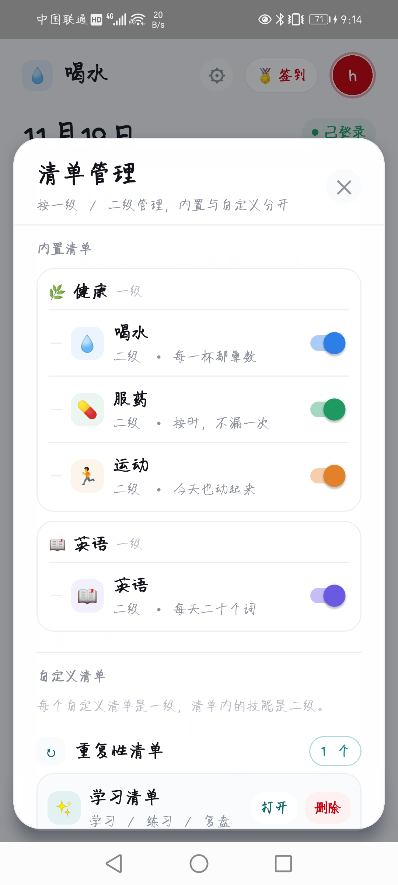
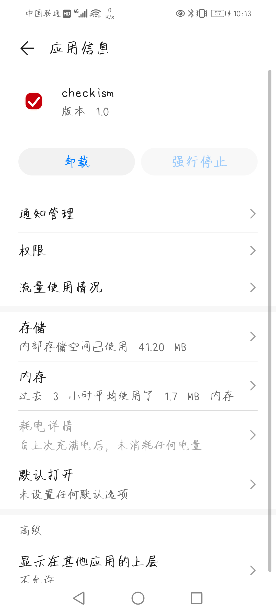

# checkism 全景记录

> 单一事实来源（Single Source of Truth）
> 最后更新：2026-11-17
> 仓库：https://github.com/xinyuan-noname/ict
> 作品：**check · 每日健康清单**

本文档记录 checkism 的产品、技术、团队、构建、测试、部署、AI 模型、比赛提交和当前限制。其他文档作为专题展开，本文件用于快速了解全貌。

---

## 0. 基本信息

| 项目 | 内容 |
|---|---|
| 作品名称 | check · 每日健康清单 |
| 队伍名称 | **闪队** |
| 学校 | **天津工业大学** |
| 指导教师 | **李杰** |
| 队长 | **陈皓庭** |
| 队长电话 | **18708477617** |
| 队长邮箱 | **3236256044@qq.com** |
| 队员 | **陈皓庭、白德布鑫、潘振宇** |
| 参赛赛题 | 第十一届华为 ICT 大赛中国创新赛 · 赛题 1 |
| 应用领域 | 生活服务 / 健康管理 |
| 技术栈 | React Native + TypeScript + Go 标准库 + 华为云 ECS/RDS/DCS + Ollama |
| 开源协议 | MIT |

### 团队分工（提交前可按实际调整）

| 成员 | 主要工作 |
|---|---|
| 陈皓庭 | 项目统筹、后端与云部署、接口联调 |
| 白德布鑫 | 客户端页面、交互与设计系统 |
| 潘振宇 | 测试、文档、演示与验收 |

---

## 1. 当前状态

| 能力 | 状态 | 说明 |
|---|---|---|
| Web / Android 客户端 | 已完成 | React Native 0.76.9，TypeScript |
| 华为账号登录 | 已完成 | Android 真机 `hid36683688` 登录成功 |
| 游客模式 | 已完成 | 本地保存、零出网 |
| 饮水 / 服药 / 运动 | 已完成 | 记录、统计、成就 |
| 英语听说读写 | 已完成 | 一级英语，二级听/说/读/写 |
| 条目级进度与周期目标 | 已完成 | 天 / 周 / 月 |
| 对数插值成就 | 已完成 | 英语 12 个序列生成 56 项成就 |
| 截止性清单 | 已完成 | 自定义清单可切换重复性 / 截止性；截止清单按事项勾选，不按天重复 |
| 清单管理 | 已完成 | 顶部齿轮管理自定义清单，开关内置清单并本地持久化 |
| AI 自定义清单 | 本地验证完成 | Ollama `qwen2.5:0.5b` 已跑通 |
| 华为云 ECS 部署 | 待执行 | 需 ECS、SSH、域名和 AGC 生产配置 |
| 自动同步 | 已准备 | GitHub Actions + `deploy/auto-deploy.sh` |
| RDS / DCS 实际接入 | 待执行 | 方案、schema、探活已准备 |

> 结论：应用主体、AI 生成和部署脚本已完成；华为云真实资源上的首次部署尚未执行，不能标记为“已上线”。

---

## 2. 产品信息架构

```text
底部导航
├─ 清单
├─ 洞察
└─ 我的

一级分类
├─ 健康
│  ├─ 喝水
│  ├─ 服药
│  └─ 运动
├─ 英语
│  ├─ 听
│  ├─ 说
│  ├─ 读
│  └─ 写
└─ 自定义（AI 生成，标题可变）
```

### 交互规则

- 一级分类决定主题色和主标题。
- 底部「清单」页签根据当前清单类型显示：重复性清单显示「重复」+ 循环图标；截止性清单显示「截止」+ 倒计时图标。
- 英语二级「听 / 说 / 读 / 写」在清单页顶部切换；选中后顶部标题、图标、洞察统计和成就同步跟随。
- 洞察页只保留「统计 / 成就」，不再重复听/说/读/写。
- 清单页负责日常记录，洞察页负责统计和成就。
- 自定义清单生成后，一级标题使用模型返回的标题，二级技能使用模型返回的 skills。
- 顶部齿轮打开「清单管理」：开关喝水 / 服药 / 运动 / 英语，打开或删除自定义清单。

---

## 3. 功能清单

### 3.1 健康

- **喝水**：身体档案计算目标；杯 / 瓶 / 自定义单位；记录撤销。
- **服药**：早 / 中 / 晚 / 睡前四时段；补打；撤回。
- **运动**：步行 / 骑行 / 跑步；周 / 月 / 季度统计；步行 / 骑行 / 配速 / 距离 / 连击成就。

### 3.2 英语

| 技能 | 内容 | 单位 |
|---|---|---|
| 听 | 听力词汇、VOA、六级听力、精听、观影 | 词 / 章 / 篇 / 部 |
| 说 | 口语练习、跟读 | 次 / 篇 |
| 读 | 百词斩、阅读、阅读词汇 | 词 / 页 |
| 写 | 英语写作、仿写 | 篇 |

- 每条清单独立 `itemProgress` / `itemTargets`。
- 目标支持按天 / 按周 / 按月。
- 快捷记录只更新对应技能系列，不误加其他系列。
- 成就使用起点 / 终点 / 阶数对数插值，不再逐条写阈值。

### 3.3 自定义清单

1. 用户输入自然语言目标；
2. 后端 `/v1/custom-plans/generate` 调用 Ollama；
3. 模型生成一级标题、二级技能、成就序列；
4. 服务端归一化并校验；
5. 客户端保存到本机，生成 skill tabs 和成就卡片。

### 3.4 截止性清单

自定义清单生成时可以选择两种类型：

```text
重复性：按天 / 周 / 月持续记录
截止性：在指定日期前完成，按事项勾选，不按天重复
```

截止性清单包含：

- 截止日期 `YYYY-MM-DD`
- 剩余天数 / 已截止提示
- 完成事项数 / 总事项数
- 事项级勾选，完成后不再重复
- 成就页仍可查看每个事项的完成状态

现有健康、英语清单属于重复性；截止性通过「自定义 → 截止性」新增。

### 3.5 清单表单与清单管理

自定义清单生成后以「清单表单」呈现：按二级技能分组，每行复选框 + 名称 + 描述 + 完成状态，风格接近 STUDY 里的 Markdown 清单：

```text
阅读
- [ ] 入门 —— ...
- [x] 熟练 —— ...
```

顶部齿轮「清单管理」支持：

- 开关内置清单：喝水 / 服药 / 运动 / 英语；
- 查看当前自定义清单类型（重复性 / 截止性）和技能数；
- 打开或删除自定义清单；
- 关闭的清单不再出现在分类清单行，并自动回落到可用清单。



### 3.4 账号与数据

- 华为 Account Kit 授权码登录；
- 游客本地预览；
- 积分、签到、头像框、宠物；
- 云资源健康探活。

---

## 4. 技术架构

```text
React Native（Web / Android）
        │ HTTPS / JSON
        ▼
Nginx（静态资源 + /v1 同源反代）
        │
        ▼
authd（Go 标准库）
handler → service → port ← adapter
        │                    │
        │                    ├── filestore
        │                    ├── Huawei Account Kit
        │                    ├── WeChat
        │                    └── Ollama
        ▼
RDS MySQL / DCS Redis（云上）
```

### 分层

| 层 | 职责 |
|---|---|
| handler | HTTP、鉴权、错误包络 |
| service | 业务规则、事务、限流 |
| port | 仓储与外部能力接口 |
| adapter | 文件存储、华为账号、Ollama 等实现 |
| domain | 模型、校验、统计算法 |

### 客户端关键目录

```text
app/src/features/*          按清单拆分的 Today / Stats / Achievements
app/src/features/registry.tsx 面板注册表
app/src/navigation/*         一级 / 二级 / 洞察状态
app/src/ui/*                 设计令牌与基础组件
app/src/model/*              数据模型、对数插值
app/src/auth/*               登录态与安全存储
```

---

## 5. 数据模型

### 英语

```ts
target: number
wordsByDay: Record<day, number>
itemProgress: Record<itemId, number>
itemTargets: Record<itemId, number>
dailyBySkill: Record<skill, Record<day, number>>
targetsBySkill: Record<skill, number>
periodsBySkill: Record<skill, 'day' | 'week' | 'month'>
```

### 自定义清单

```ts
CustomPlanState {
  plan: { title, icon, description, skills[] }
  itemProgress
  itemTargets
  dailyBySkill
  targetsBySkill
  periodsBySkill
}
```

### 成就序列

```ts
{ id, name, desc, icon, start, end, steps, pointsStart, pointsEnd }
```

生成：

```text
need[i] = start * (end / start) ^ (i / (steps - 1))
```

首尾固定，取整并保证严格递增；英语 12 个序列生成 56 个成就。

---

## 6. AI 小模型

### 本地运行状态

```text
Ollama 0.40.13
模型：qwen2.5:0.5b
大小：约 397 MB
地址：http://127.0.0.1:11434
```

- 从 Ollama Windows ZIP 中仅提取 CPU 运行文件，避免下载 1.5 GB GPU 依赖。
- 模型已拉取并完成真实生成测试。
- 0.5B 输出不够稳定，服务端已做归一化：
  - 非法 ID 自动生成；
  - 缺少 `{need}` 自动补全；
  - `steps` 限制 3-8；
  - 空技能 / 空序列补默认项；
  - 重复项去重。

### 后端接口

```http
POST /v1/custom-plans/generate
Authorization: Bearer <sessionToken>
Content-Type: application/json

{"need":"我想用 3 个月准备考研，每天学数学、英语和政治"}
```

### 相关配置

```dotenv
OLLAMA_BASE_URL=http://127.0.0.1:11434
OLLAMA_MODEL=qwen2.5:0.5b
OLLAMA_TIMEOUT=60s
OLLAMA_FALLBACK=1
```

生产建议使用 `qwen2.5:1.5b` 或更强模型；0.5B 适合低配 ECS / 演示。

---

## 7. 华为云部署

### 资源

| 资源 | 用途 |
|---|---|
| ECS | Nginx + authd + Ollama |
| RDS for MySQL | 用户、会话、清单数据 |
| DCS for Redis | 缓存 / 限流 |
| ELB / WAF | HTTPS、域名 |
| AGC | 华为账号 Client ID / 回调 |
| SWR（可选） | 镜像仓库 |

### 部署文件

```text
deploy/docker-compose.yml    web / authd / ollama / mysql / redis / hwsim
deploy/Dockerfile.server
deploy/Dockerfile.web
deploy/nginx.conf
deploy/ecs-bootstrap.sh
deploy/auto-deploy.sh
deploy/env.example
```

### Compose 中的 Ollama

```yaml
ollama:
  image: ollama/ollama:0.40.13
  volumes:
    - ollama-models:/root/.ollama

ollama-init:
  image: ollama/ollama:0.40.13
  command: ["ollama pull ${OLLAMA_MODEL:-qwen2.5:0.5b}"]
```

首次启动自动拉取模型；authd 通过 `http://ollama:11434` 调用。

### 首次部署

本地测试当前使用 `LOCAL_TEST_API=true`，Android 构建直接访问电脑局域网：

```text
http://192.168.137.1:8443
```

同时 `app/android/app/src/release/AndroidManifest.xml` 允许局域网 HTTP，便于本地 Release 包脱离 Metro 打开。

> 正式上云前必须：把 `app/src/shared/config.ts` 的 `LOCAL_TEST_API` 改为 `false`，恢复生产 HTTPS 域名，并移除 release 的 cleartext 配置。

### 本地登录前必须启动 authd

手机登录失败时先检查电脑后端，而不是重复点登录：

```powershell
# 终端 1：启动后端（保持窗口不关）
powershell -ExecutionPolicy Bypass -File scripts/start-authd-real.ps1

# 终端 2：确认电脑和局域网都可访问
curl http://127.0.0.1:8443/v1/health
curl http://192.168.137.1:8443/v1/health
```

手机与电脑必须同一局域网，且 Windows 防火墙放行 TCP 8443。健康检查返回 `status: ok` 后再打开 App。

`scripts/start-authd-real.ps1` 会把 `SESSION_PEPPER` 保存到 `server/data/session.pepper`（本地忽略文件）。不要每次启动都生成新 pepper，否则旧会话会全部失效，App 会提示 `AUTH_005 登录已过期`。

当前本地验证结果：authd 启动后，华为账号 `hid36683688` 登录成功，云端同步开启。

```bash
sudo mkdir -p /opt/check
sudo chown "$USER" /opt/check
git clone git@github.com:xinyuan-noname/ict.git /opt/check
cd /opt/check
cp deploy/env.example deploy/.env
vi deploy/.env
sudo bash deploy/ecs-bootstrap.sh
docker compose -f deploy/docker-compose.yml --env-file deploy/.env up -d --build
```

### 生产环境变量

```dotenv
ENV=production
AUTH_MODE=real
AUTH_ALLOW_MOCK=0
AUTH_STORAGE_NAMESPACE=cloud
SESSION_PEPPER=<32字节随机值>
HUAWEI_CLIENT_ID=<AGC Client ID>
HUAWEI_CLIENT_SECRET=<AGC Client Secret>
WINDOWS_REDIRECT_URI=https://<domain>/auth/windows/callback
OLLAMA_MODEL=qwen2.5:0.5b
OLLAMA_FALLBACK=0
```

---

## 8. 自动同步

### GitHub Actions

```text
push main
  → .github/workflows/deploy-huaweicloud.yml
  → SSH 到 ECS
  → cd /opt/check && bash deploy/auto-deploy.sh
  → git reset --hard origin/main
  → docker compose build/up
  → /v1/health 检查
  → 失败回滚上一 commit
```

GitHub Secrets：

```text
HUAWEI_ECS_HOST
HUAWEI_ECS_USER
HUAWEI_ECS_SSH_KEY
HUAWEI_ECS_PORT
HUAWEI_ECS_DEPLOY_PATH
```

### CodeArts / Jenkins

`deploy/auto-deploy.sh` 不依赖 GitHub Actions，可由 CodeArts 流水线或 Jenkins 的 Shell 任务直接执行。

详细步骤：[deploy/README.md](../deploy/README.md)

---

## 9. 构建与测试

### 前端

```bash
cd app
npm run typecheck
npm test
npm run web:build
```

当前基线：

```text
前端 Jest：22 个测试文件、120 项通过
TypeScript：通过
Webpack：生产构建通过
```

### 后端

```bash
cd server
go build ./...
go test ./...
```

覆盖：

- 登录 / 会话 / 鉴权
- 清单 / 饮水 / 服药 / 运动
- 奖励 / 宠物 / PK
- 自定义清单生成与回退
- 云资源健康探活

> 已知既有测试 `TestLedgerOrderAndPaging` 偶发分页重叠，与自定义清单功能无关；如长时间稳定复现，应单独修复。

### 密钥扫描

```bash
npm run secret:scan
```

---

## 10. 图标与品牌

应用图标已自定义：


Android 真机应用信息页：



- 主色：品牌红 `#C7000B`
- 背景：暖白 `#FFF8F3`
- 白色对勾 + 青色小点
- Android：
  - `mipmap-* / ic_launcher.png`
  - `mipmap-* / ic_launcher_round.png`
  - `mipmap-anydpi-v26 / ic_launcher.xml`
  - `drawable-nodpi / ic_launcher_foreground.png`
  - `values/colors.xml`
- Web：
  - `app/web/favicon.png`
  - `app/web/icon-192.png`
  - `app/web/icon-512.png`
  - `index.html` 中内联 favicon / apple-touch-icon
- 源文件：
  - `app/assets/brand/icon-master.png`
  - `app/assets/brand/icon-foreground.png`
  - `app/assets/brand/icon-round.png`
  - 生成脚本：`scripts/generate-app-icon.py`

---

## 11. 关键文件索引

```text
app/                         React Native 客户端
app/src/features/            健康 / 英语 / 自定义 / 我的
app/src/model/               数据模型、对数插值
app/src/ui/                  设计系统
app/src/api/                 客户端 API
server/                      Go 服务端
server/internal/handler/     HTTP
server/internal/service/     业务
server/internal/port/        接口
server/internal/adapter/     存储 / 华为 / Ollama
deploy/                      Docker / ECS / 自动同步
docs/                        设计、部署、报告、验收
contracts/                   OpenAPI
db/schema.sql                MySQL schema
```

---

## 12. 比赛提交材料

| 材料 | 说明 |
|---|---|
| 作品信息收集表 | `docs/【赛题1-作品信息收集表】闪队-已填写.docx`（本地，Git 忽略） |
| 项目完成报告 | `docs/项目完成报告-闪队-已填写.docx`（本地，Git 忽略） |
| 提交压缩包 | `release/赛题1-天津工业大学-闪队-陈皓庭-18708477617.zip`（本地，Git 忽略） |
| Markdown 报告 | `docs/completion-report-template.md`（Git 跟踪） |
| 作品截图 | `docs/screenshots/`、`release/.../作品截图/` |

官方命名规则：

```text
赛题1-学校-队名-队长姓名-手机号
```

当前：

```text
赛题1-天津工业大学-闪队-陈皓庭-18708477617
```

> 团队合照暂未提供；官方说明允许在“团队合照”一栏备注“暂无队伍合照”。

---

## 13. 已知限制与待办

1. 华为云 ECS 尚未实际部署；需要 ECS、SSH、域名与 AGC 生产配置。
2. RDS / DCS 当前是 schema 和探活准备，文件存储仍是默认数据面。
3. `qwen2.5:0.5b` 生成质量有限，建议生产使用 1.5B 或更强模型。
4. iOS / Windows 原生构建尚未验证。
5. 性能压测、长稳测试、真实设备多机型覆盖待补。
6. 团队合照、演示视频、CodeArts 对话截图待补。
7. 历史 Git 提交中仍包含早期 docx；当前索引已通过 `*.docx` 忽略。

---

## 14. 版本记录

| 提交 | 内容 |
|---|---|
| `a8dfce8` | 兼容小模型输出并规范成就结构 |
| `a103477` | 华为云 Ollama compose 与自动同步 |
| `5d05a1a` | 项目完成报告与赛题 1 作品信息模板 |
| `31f9a8e` | 填写学校/指导教师并忽略 docx |
| `0bf9d05` | 队伍名称更新为闪队 |
| `75c84ec` | 忽略 release 提交包 |
| `2fc0e84` | 设置 checkism 图标并新增全景记录 |
| `e24e7bb` | 新增截止性清单类型 |
| `ea7d837` | 清单管理、类型底栏与表单视图 |

---

## 15. 常用命令

```bash
# 前端
cd app
npm install
npm run typecheck
npm test

# 后端
cd ../server
go build ./...
go test ./...

# Web 构建
cd ../app
npm run web:build

# 密钥扫描
cd ..
npm run secret:scan
```

---

## 16. 相关文档

- [README](../README.md)
- [赛题交付说明](track1.md)
- [部署手册](../deploy/README.md)
- [Ollama 说明](ollama.md)
- [项目完成报告](completion-report-template.md)
- [验收报告](acceptance-report.md)
- [开发 Skill](skills/checkism/SKILL.md)
